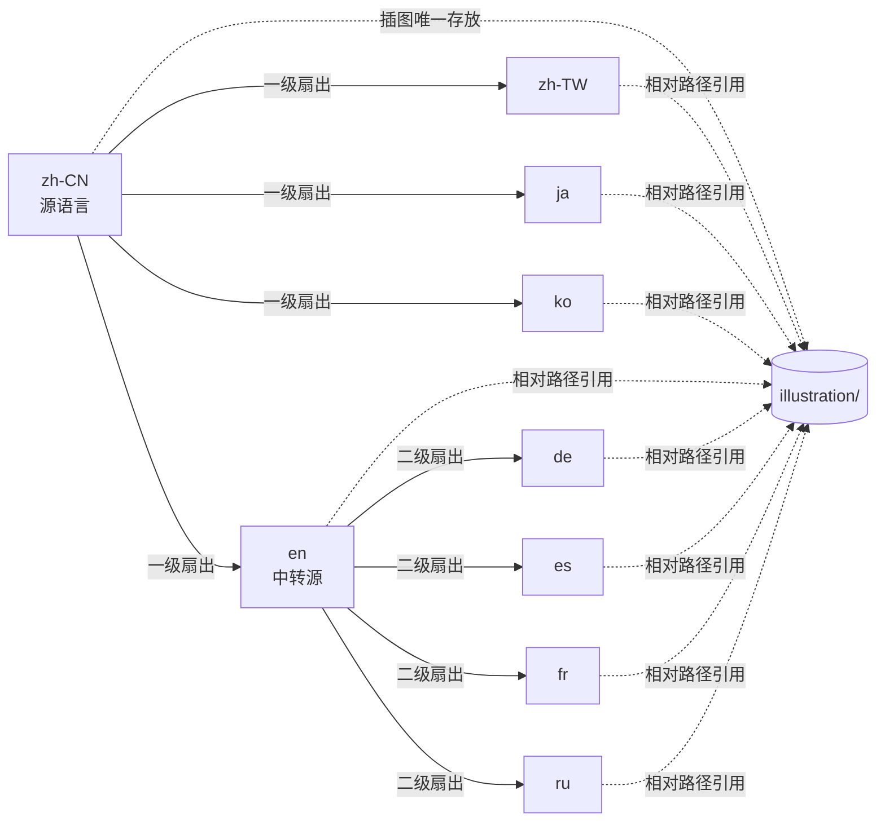

# 设计文档

## 概览

本设计文档面向 `multilingual-blueprint-workflow` 这一组织级流水线特性，覆盖：

- 仓库的「Git 追踪范围收敛」与既有空白 `start.md` 文件清理；
- 中文简体蓝图（`docs/zh-CN/blueprint/`）的目录、命名、模板与插图引用规范，并以 **MeriToken（中文主用名「美誉值」）的深度分析** 作为蓝图的内容主轴；
- 以中文简体为唯一源、按 `zh-CN → {zh-TW, ja, ko, en} → {de, es, fr, ru}` 链路扇出至九种语言的翻译流水线；
- 跨语言结构、术语、章节层级与插图引用的对齐机制；
- 阶段门控、风险兜底与可执行的正确性属性。

本蓝图的中心议题是 MeriToken 在新社会中的双重定位：**契约部件** 与 **社会关系连接器**。围绕 MeriToken 展开的技术原理、社会内涵、引用与应用、与 credential 的关系等议题构成蓝图主线。

ifay 体系、Global Merit Chain（GMC）、Fay、agent 对照、phase 演进路线、整体框架等议题，定位为 **MeriToken 分析所需的支撑性背景**：仅在 MeriToken 的展开必须涉及时给出最小必要的位置说明，并通过 `Upstream_Project_Doc_Link` 将读者引导至 ifay.ai 上对应的官方文档页，本仓库内不再对这些上游/外围议题做长篇阐述。

设计目标可概括为四条：

1. **唯一来源（Single Source of Truth）**：`zh-CN` 是写作源，`en` 是二级扇出的中转源，其他语言全部派生。
2. **结构同构（Structural Isomorphism）**：所有语言的蓝图目录在文件名、章节层级、插图引用语义上保持镜像一致。
3. **门控可证（Gated & Auditable）**：阶段间转入条件可机读，可在 commit / PR 元数据中留痕。
4. **最小追踪面（Minimal Tracking Surface）**：在文档定稿前，仓库仅放行 `docs/`、`README.md`、`LICENSE`、`.gitignore`、`.kiro/`，其余路径默认不入版本库。

## 架构

### 整体阶段链路

```mermaid
stateDiagram-v2
    direction LR
    [*] --> A
    A: 阶段 A — 仓库清理 & 追踪面收敛
    B: 阶段 B — zh-CN 蓝图撰写（MeriToken 为主轴）
    C: 阶段 C — 一级扇出 zh-CN → {zh-TW, ja, ko, en}
    D: 阶段 D — 二级扇出 en → {de, es, fr, ru}
    A --> ReviewA: start.md 清零 + .gitignore 验证通过
    ReviewA: 校对门 G_A
    ReviewA --> B
    B --> ReviewB: 全部 Topic_Slug 主题 + README + glossary 完稿
    ReviewB: 校对门 G_B (Human_Reviewer 通读)
    ReviewB --> C
    C --> ReviewC: en 通读校对完成
    ReviewC: 校对门 G_C (en 是二级源)
    ReviewC --> D
    D --> ReviewD: de/es/fr/ru 各自通读完成
    ReviewD: 校对门 G_D
    ReviewD --> [*]
```



四个校对门 `G_A / G_B / G_C / G_D` 是阶段转换的硬约束，详见「链路依赖与阶段门」章节。

### 翻译扇出依赖图



实线箭头表示翻译派生关系，虚线箭头表示插图相对路径引用。`zh-CN` 是图片的唯一物理存放点，所有其他语言通过相对路径回引。

## 组件与接口

本特性是「文档生产 + 仓库治理」的混合体，没有运行时服务，所谓「组件」更接近于工具/产物分层。

| 组件 | 形态 | 职责 | 关键产物 |
|------|------|------|----------|
| Repo_Hygiene | Git 配置 + 一次性清理动作 | 删除空 `start.md`，收敛追踪面 | `.gitignore`、`git rm --cached` 操作 |
| Source_Authoring | 人工写作 | 撰写 `zh-CN` 蓝图原稿（MeriToken 为主轴） | `docs/zh-CN/blueprint/*.md` |
| Glossary_Authority | 人工维护的词典 | 提供跨语言术语一致性，承载 `Reserved_Term` / `Localized_Term` / `Upstream_Project_Doc_Link` | `docs/{lang}/blueprint/glossary.md` |
| Translation_Tool | LLM 辅助 + 提示词模板 | 执行首轮机器翻译 | 各目标语言 `.md` 草稿 |
| Human_Review | 人工通读 | 校对术语、流畅度、结构 | 校对签字（commit trailer） |
| Structure_Validator | 校验脚本（可选） | 检查文件名集合、章节层级、插图路径 | CI 报告 / 本地 lint 输出 |
| Reserved_Term_Guard | 后处理脚本（可选） | 校验译文未漂移 `Reserved_Term`，并校验 `Localized_Term` 命名规则 | 命中报告 |

### Translation_Tool 接口约定

`Translation_Tool` 不规定具体实现产品，但其调用契约固定：

- **输入**：源文件路径、源语言代码、目标语言代码、`Glossary_File` 注入物（system prompt 形式）、`Reserved_Term` 列表、`Localized_Term` 规则。
- **输出**：与源文件同名的目标语言 Markdown 文件，章节层级与图片相对路径保持原样。
- **不变量**：
  - 不得改写 ` ```mermaid ` 代码块、表格结构、Markdown 图片语法的 alt 文本中的 `Reserved_Term`。
  - 不得修改图片相对路径段（`../../zh-CN/blueprint/illustration/...` 与 `./illustration/...`）。
  - 不得新增/删除一级标题与二级标题；可保留三级及以下标题层级数量。
  - 对 MeriToken 这一概念按 `Localized_Term` 规则处理：当目标语言为 `zh-CN` 或 `zh-TW` 时，主用名为「美誉值」，并允许首次出现处括注 `MeriToken`；其余语言主用 `MeriToken`，不得替换为本地化译名。

推荐方案：以 LLM（如 Claude / GPT-4 级别模型）为执行内核，将 `Glossary_File` 的「英文原词 / 中文释义 / 翻译策略」三列作为系统提示词注入，再附 `Reserved_Term` 黑名单约束「以下词必须保留英文原形」与 `Localized_Term` 规则约束「MeriToken 按目标语言切换主用名」。可选实现包括：

1. **方案 A（推荐）**：LLM 单次按文件翻译 + 后处理脚本校验 `Reserved_Term` 与 `Localized_Term`。流程简单，适合单仓维护。
2. **方案 B**：LLM 按章节切片翻译（按 `##` 切分）+ 拼接。可降低长文出错率，但需要拼接逻辑。
3. **方案 C**：传统机器翻译（如 DeepL）+ 人工后编辑。对 `Reserved_Term` / `Localized_Term` 控制弱，不推荐。

本设计采用方案 A，并在「翻译流水线设计」中给出注入模板。

## 数据模型

### 目录与文件布局

经过本特性后，仓库的关键目录结构如下（仅展示与本特性相关的部分）：

```
ifay-meritoken/
├── .gitignore                              # 黑名单兜底 + 白名单反向放行
├── .kiro/                                  # 规格与计划，纳入追踪
│   └── specs/multilingual-blueprint-workflow/
│       ├── .config.kiro
│       ├── requirements.md
│       └── design.md
├── LICENSE
├── README.md
└── docs/
    ├── zh-CN/                              # 源语言（Source_Language）
    │   └── blueprint/
    │       ├── README.md                   # Blueprint_Index
    │       ├── glossary.md                 # 术语表（Glossary_File）
    │       ├── 00-readers-guide.md
    │       ├── 01-meritoken-overview.md
    │       ├── 02-meritoken-technical.md
    │       ├── 03-meritoken-social.md
    │       ├── 04-meritoken-usage.md
    │       ├── 05-meritoken-credential.md
    │       ├── 06-meritoken-deep-cases.md
    │       ├── 07-related-projects.md
    │       └── illustration/               # 唯一图片目录（Illustration_Dir）
    │           ├── credential-management.png
    │           ├── human-operation-era.png
    │           ├── ifay-framework-alpha1.png
    │           ├── ifay-title-banner.png
    │           ├── ifay-vs-agent.png
    │           ├── phase1-architecture.png
    │           ├── phase1-concept.png
    │           ├── phase2-architecture.png
    │           ├── phase2-concept.png
    │           ├── phase3-architecture.png
    │           ├── phase3-concept.png
    │           ├── phase4-architecture.png
    │           ├── phase4-concept.png
    │           └── phase5-concept.png
    ├── zh-TW/blueprint/                    # 一级扇出
    │   ├── README.md
    │   ├── glossary.md
    │   └── 00-readers-guide.md … 07-related-projects.md
    ├── ja/blueprint/                       # 一级扇出
    │   └── …（同上）
    ├── ko/blueprint/                       # 一级扇出
    │   └── …（同上）
    ├── en/blueprint/                       # 一级扇出 + 二级中转源
    │   └── …（同上）
    ├── de/blueprint/                       # 二级扇出
    │   └── …（同上）
    ├── es/blueprint/                       # 二级扇出
    │   └── …（同上）
    ├── fr/blueprint/                       # 二级扇出
    │   └── …（同上）
    └── ru/blueprint/                       # 二级扇出
        └── …（同上）
```

设计要点：

- 每种语言的 `blueprint/` 下固定为 **10 个 Markdown 文件**：`README.md` + `glossary.md` + 8 份主题文档（`00-readers-guide.md` 至 `07-related-projects.md`）。
- `illustration/` 仅存在于 `docs/zh-CN/blueprint/`，其他语言不复制副本。
- 各语言目录原有的同级子目录（`community/`、`develop/`、`images/`、`sdk/`、`specification/`）不在本特性的修改范围内。
- 根级仅 `.gitignore`、`README.md`、`LICENSE`、`.kiro/`、`docs/` 进入白名单。
- `illustration/` 下既有 14 张 PNG。其中 `credential-management.png` 在新蓝图中被强制引用（见 `05-meritoken-credential.md`）；其余「ifay/phase 系列」图作为外围议题的可选辅助插图，是否引用由 `07-related-projects.md` 决定。**`illustration/` 下未被任何 `.md` 引用的孤立图片在本特性下被允许存在**，不构成 P3 校验失败。

### 主题文件序号映射（新蓝图，MeriToken 为主轴）

旧版本的 14 篇主题（`00-overview` / `01-human-operation-era` / `02-ifay-vs-agent` / `03-framework` / `04-phase1` … `08-phase5` / `09-credential-management` / `10-meritoken-overview` / `11-meritoken-technical` / `12-meritoken-social` / `13-meritoken-usage`）被以下 8 篇新主题替换。MeriToken 直接相关主题数为 **6**（01–06），其他主题数为 **2**（00 阅读指南 + 07 相关项目），满足需求 4.4 的「不少于其他主题数之和」。

| 序号 | 文件名 | 主题归类 | 主题简介 | 关联插图（强制 / 可选） |
|------|--------|----------|----------|------------------------|
| 00 | `00-readers-guide.md` | 阅读指南 | 蓝图定位、读者画像、阅读路径建议；引导读者直接进入 MeriToken 主线 | 可选：`ifay-title-banner.png`（章首横幅） |
| 01 | `01-meritoken-overview.md` | MeriToken | 美誉值（MeriToken）概览：与 GMC 的从属关系；独立成项目的两项理由（契约部件 / 社会关系连接器） | 待补图：`meritoken-overview-contract.png` |
| 02 | `02-meritoken-technical.md` | MeriToken | 技术原理：加密 / 存储 / 取用 / 隐私保证 / 所有权与使用权保证 | 待补图：`meritoken-technical-flow.png` |
| 03 | `03-meritoken-social.md` | MeriToken | 社会内涵：社会关系 / 政治逻辑 / 经济结构 / 个人成长映射 / 个人贡献与社会话语权的映射含义 | 待补图：`meritoken-social-mapping.png` |
| 04 | `04-meritoken-usage.md` | MeriToken | 引用与应用：个人主体 vs Fay 主体的引用方式与应用场景 | 待补图：`meritoken-usage-comparison.png` |
| 05 | `05-meritoken-credential.md` | MeriToken（支撑面） | credential 与美誉值的关系：凭证 / 美誉值的边界与对位关系 | 强制：`credential-management.png`（暂复用），并预留待补图：`meritoken-credential-boundary.png` |
| 06 | `06-meritoken-deep-cases.md` | MeriToken（扩展位） | 进阶专题（如美誉值在跨主体协作中的高密度使用、滚动场景）；预留扩展位 | 待补图（slot 由本篇按需登记） |
| 07 | `07-related-projects.md` | 相关项目（外围） | 与 ifay 体系的关系：最小必要位置说明 + 指向 ifay.ai 官方文档页的外链清单（ifay / GMC / Fay / agent / phase / 整体框架） | 可选：从 ifay/phase 系列既有 PNG 中按需选用 1–3 张作为辅助 |

主题分配的统计如下：

- MeriToken 直接相关主题：6 篇（01 / 02 / 03 / 04 / 05 / 06）
- 其他主题：2 篇（00 阅读指南、07 相关项目）
- 6 ≥ 2，满足需求 4.4。
- 02 / 03 / 04 三篇分别独立承载技术原理 / 社会内涵 / 引用与应用，构成 MeriToken 主题集合的最小骨架，满足需求 4.5。
- 01 承担 GMC 从属关系陈述与「契约部件 / 社会关系连接器」两项理由，满足需求 4.6。
- 07 是「上游/外围议题」唯一收敛主题，主体形态为「最小必要位置说明 + 外链清单」，满足需求 4.7、4.8。

### 既有插图的处理策略

`docs/zh-CN/blueprint/illustration/` 下既有 14 张 PNG。新蓝图按以下策略消化：

| PNG 文件 | 旧主题 | 新蓝图归宿 | 说明 |
|----------|--------|------------|------|
| `credential-management.png` | 旧 `09-credential-management.md` | **强制引用** 进 `05-meritoken-credential.md` | 凭证管理图直接服务于美誉值 / credential 的边界讨论 |
| `ifay-title-banner.png` | 旧 `00-overview.md` | 可选：`00-readers-guide.md` 章首横幅 | 不强制；本图属装饰性 |
| `human-operation-era.png` | 旧 `01-human-operation-era.md` | 可选：`07-related-projects.md` | 作为「上游议题位置说明」的辅助插图 |
| `ifay-vs-agent.png` | 旧 `02-ifay-vs-agent.md` | 可选：`07-related-projects.md` | 同上 |
| `ifay-framework-alpha1.png` | 旧 `03-framework.md` | 可选：`07-related-projects.md` | 同上 |
| `phase1-concept.png` / `phase1-architecture.png` | 旧 `04-phase1.md` | 可选：`07-related-projects.md` | 同上 |
| `phase2-concept.png` / `phase2-architecture.png` | 旧 `05-phase2.md` | 可选：`07-related-projects.md` | 同上 |
| `phase3-concept.png` / `phase3-architecture.png` | 旧 `06-phase3.md` | 可选：`07-related-projects.md` | 同上 |
| `phase4-concept.png` / `phase4-architecture.png` | 旧 `07-phase4.md` | 可选：`07-related-projects.md` | 同上 |
| `phase5-concept.png` | 旧 `08-phase5.md` | 可选：`07-related-projects.md` | 同上 |

原则：

- **新蓝图不强制使用「ifay/phase 系列」既有 PNG**。这些图属于上游/外围议题的可选辅助；`07-related-projects.md` 可按写作需要选用 1–3 张，也可全部不引用。
- **MeriToken 主题集合（01–06）的待补图 slot** 在 `Blueprint_Index` 的「待补图清单」中明确登记，使用统一的 `⏳ 待补图` 占位符样式。
- **P3 校验的输入是「`.md` 中实际出现的图片引用」**，而非「`illustration/` 下的所有图片」。`illustration/` 下未被任何 `.md` 引用的孤立 PNG 不构成 P3 失败。

### MeriToken 主题集合的待补图 slot 清单

```
01-meritoken-overview.md   → meritoken-overview-contract.png
                              （契约部件 + 社会关系连接器并图）
02-meritoken-technical.md  → meritoken-technical-flow.png
                              （加密 / 存储 / 取用闭环）
03-meritoken-social.md     → meritoken-social-mapping.png
                              （社会关系 / 政治逻辑 / 经济结构 /
                                 个人成长 / 话语权映射）
04-meritoken-usage.md      → meritoken-usage-comparison.png
                              （个人主体 vs Fay 主体引用对比）
05-meritoken-credential.md → meritoken-credential-boundary.png
                              （美誉值 / credential 边界与对位；
                                 暂可复用 credential-management.png）
06-meritoken-deep-cases.md → 由本篇按需登记 slot
```

### 受控值集合

设计中需要被多处引用的常量集合：

- `Language_Code = {de, en, es, fr, ja, ko, ru, zh-CN, zh-TW}`（按字母序，共 9 个）
- `Tier1_Targets = {zh-TW, ja, ko, en}`（一级扇出，4 个）
- `Tier2_Targets = {de, es, fr, ru}`（二级扇出，4 个）
- `Reserved_Term = {ifay, agent, phase, credential, GMC, Fay}`（**不含 MeriToken**，6 个）
- `Localized_Term = {MeriToken / 美誉值}`（按语言区分主用名；zh-CN/zh-TW 主用「美誉值」，其余 7 种语言主用 `MeriToken`）
- `Upstream_Project_Doc_Link` 钉死映射（详见下表）
- `Topic_Slug = {00-readers-guide, 01-meritoken-overview, 02-meritoken-technical, 03-meritoken-social, 04-meritoken-usage, 05-meritoken-credential, 06-meritoken-deep-cases, 07-related-projects}`（共 8 项）
- `Tracked_Path_Whitelist = {docs/, README.md, LICENSE, .gitignore, .kiro/}`

### Upstream_Project_Doc_Link 钉死表

需求文档不约束具体 URL，本设计层定稿如下占位形态。**域名固定为 `ifay.ai`**，路径采用 `https://ifay.ai/docs/{slug}` 约定。如 ifay.ai 文档发布方在落地前提供更精确的 URL，由实施阶段以「不变更域名」为前提替换。

| 上游术语 | Upstream_Project_Doc_Link |
|----------|---------------------------|
| ifay     | `https://ifay.ai/docs/ifay` |
| GMC      | `https://ifay.ai/docs/gmc` |
| Fay      | `https://ifay.ai/docs/fay` |
| agent    | `https://ifay.ai/docs/agent` |

> 注：URL 由 ifay.ai 文档发布方在落地前确认；本设计层先定稿这套占位形态。任何替换不得改用 `ifay.ai` 之外的域名。

### Git 追踪策略数据模型

`.gitignore` 采用「先 `*` 全忽略 + 反向放行白名单」的兜底策略。草案内容如下：

```gitignore
# === multilingual-blueprint-workflow: 黑名单兜底 + 白名单反向放行 ===
# 默认忽略仓库内的一切
*

# 反向放行：白名单内的目录与文件
!.gitignore
!README.md
!LICENSE
!.kiro/
!.kiro/**

!docs/
!docs/**

# 在 docs/ 与 .kiro/ 内部继续忽略明显的临时/构建产物
docs/**/.DS_Store
docs/**/Thumbs.db
docs/**/*.tmp
docs/**/*.bak
docs/**/node_modules/
docs/**/.cache/
.kiro/**/.DS_Store
```

要点：

- 顶层 `*` 必须先于反向放行规则；`!` 规则只能放行未被父级目录 `*` 覆盖的项。
- 因为 `*` 会忽略目录本身，所以白名单里需要同时放行 `docs/` 与 `docs/**`；只放 `docs/**` 不会让 Git 看见目录入口。
- 后置的 `docs/**/.DS_Store` 等规则用于在已放行的子树里挑出杂项再次屏蔽，避免误提交。
- 不放行 `docs/zh-CN/blueprint/illustration/` 之外的图片副本，是结构层（人审与脚本）的责任，不是 `.gitignore` 的责任。

### 已追踪文件的 untrack 处理

`.gitignore` 只影响「未追踪」文件。已被追踪的文件需要显式从索引移除：

1. 列出当前追踪面：`git ls-files`。
2. 对每个不在 `Tracked_Path_Whitelist` 内的路径执行 `git rm --cached -r <path>`（保留工作区文件，仅从索引移除）。
3. 提交一次「shrink tracked surface」的 commit。
4. 之后再补 `.gitignore`，确保不会被重新 `git add`。

### Git 验证机制

每次修改 `.gitignore` 后，必须用以下命令验证：

```bash
# 白名单内路径：应当不命中（无输出，退出码 1）
git check-ignore -v docs/zh-CN/blueprint/00-readers-guide.md
git check-ignore -v README.md
git check-ignore -v .kiro/specs/multilingual-blueprint-workflow/design.md

# 白名单外路径：应当命中（输出对应规则）
git check-ignore -v scratch.txt
git check-ignore -v build/output.json
git check-ignore -v docs/en/blueprint/node_modules/foo.js
```

校验脚本可在 CI 中遍历白名单/黑名单样本并对退出码做断言；本设计阶段先以人工 checklist 形式记录。

### start.md 清理策略

九处 `docs/{Language_Code}/start.md` 已经存在于工作区。需求 1 规定：仅删除 0 字节文件；非 0 字节必须停手并报告。

判定流程：

1. **使用工具栈而非 shell**：用 `fileSearch` 定位所有 `start.md`，再用 `readFile` 取内容；空文件读出空字符串即视为 0 字节候选。`readFile` 不返回字节数，因此实际清理动作仍需在终端执行 `wc -c` 或 `stat` 二次确认。
2. **二次确认命令**（在仓库根目录运行）：

   ```bash
   for f in docs/*/start.md; do
     size=$(wc -c < "$f" | tr -d ' ')
     printf '%6s  %s\n' "$size" "$f"
   done
   ```

3. **删除条件**：仅当 `size == 0` 才执行 `git rm <path>`（如已追踪）或 `rm <path>`（如未追踪）。
4. **异常处理**：若任一文件 `size > 0`，立即停止本阶段，把路径与字节数填入「待人工确认」清单，由 `Human_Reviewer` 决定是否归档其内容到合适的目标文件再删除。
5. **完成判定**：再次执行 `find docs -name 'start.md' -type f` 应输出空列表。

不使用 `find -empty` 一把梭的原因是：需要保留「发现非空文件即停手」的安全闸；先列举再断言更可观测。

### 蓝图文档模板

#### 通用主题文档骨架

每篇 `NN-{topic-slug}.md` 采用统一骨架，方便跨语言对齐章节层级：

```markdown
# {两位序号} {主题中文标题}

> 简介段：1-2 句话陈述本主题在蓝图中的位置与读者画像。

## 背景

…承接前一主题的过渡，给出本主题要回答的问题。

## 核心内容

### {子主题 A}

…正文…


### {子主题 B}

…正文…

## 与其他主题的关系

…向前/向后承接说明，必要时用列表或表格…

## 术语脚注

- **{Reserved_Term}**：见 [glossary.md](./glossary.md#{slug})。
```

约定：

- **不引入 YAML front-matter**：避免某些 Markdown 渲染器对 front-matter 的差异化处理；元数据通过 `Blueprint_Index` 的导航表统一承载。
- **一级标题 `#`**：每篇文件唯一一个，文本以「`{两位序号} {主题}`」开头，便于侧栏目录排序。
- **二级标题 `##`**：固定包含「背景」「核心内容」「与其他主题的关系」「术语脚注」四个语义骨架，跨语言译文必须保留这四个二级标题（可本地化文本，但数量与顺序不变）。`07-related-projects.md` 因主体形态特殊，二级标题集合采用专用变体（见下文）。
- **三级标题 `###`**：按各主题需要列出子主题；译文允许本地化文本，但数量与顺序不变。
- **插图引用位置**：紧跟其首次被讨论的子章节段落之后，使用 Markdown 标准图片语法。
- **术语脚注**：列出本文出现的 `Reserved_Term`，统一回链 `glossary.md`，避免在正文里反复夹注。
- **MeriToken 概念命名**：在 `zh-CN` / `zh-TW` 正文中主用「美誉值」，并允许在该语言版本首次出现处括注 `MeriToken`；在其他语言正文中主用 `MeriToken`。

#### `Blueprint_Index`（README.md）模板

```markdown
# 蓝图索引（zh-CN）

ifay 项目蓝图围绕 **美誉值（MeriToken）** 的深度分析展开；本索引串联同目录下全部主题文档，并维护待补图清单与术语表入口。

## 阅读顺序

| 序号 | 文件 | 主题 | 关联插图 |
|------|------|------|----------|
| 00 | [00-readers-guide.md](./00-readers-guide.md) | 阅读指南 | `illustration/ifay-title-banner.png`（可选） |
| 01 | [01-meritoken-overview.md](./01-meritoken-overview.md) | 美誉值（MeriToken）概览 | 待补图：`meritoken-overview-contract.png` |
| 02 | [02-meritoken-technical.md](./02-meritoken-technical.md) | 美誉值技术原理 | 待补图：`meritoken-technical-flow.png` |
| 03 | [03-meritoken-social.md](./03-meritoken-social.md) | 美誉值社会内涵 | 待补图：`meritoken-social-mapping.png` |
| 04 | [04-meritoken-usage.md](./04-meritoken-usage.md) | 美誉值引用与应用 | 待补图：`meritoken-usage-comparison.png` |
| 05 | [05-meritoken-credential.md](./05-meritoken-credential.md) | credential 与美誉值的关系 | `illustration/credential-management.png`（暂复用），待补图：`meritoken-credential-boundary.png` |
| 06 | [06-meritoken-deep-cases.md](./06-meritoken-deep-cases.md) | 美誉值进阶专题 | 待补图（slot 由本篇按需登记） |
| 07 | [07-related-projects.md](./07-related-projects.md) | 与 ifay 体系的关系 | 可选：`ifay-framework-alpha1.png` 等 |

## 相关项目（外链）

详见 [07-related-projects.md](./07-related-projects.md)。该文档以「最小必要位置说明 + 指向官方文档页的外链清单」形态收敛 ifay / GMC / Fay / agent / phase / 整体框架等上游议题，外链指向 ifay.ai 上对应的官方文档页。

## 待补图清单

- `01-meritoken-overview.md`：契约部件 + 社会关系连接器并图（slot：`meritoken-overview-contract`）。
- `02-meritoken-technical.md`：MeriToken 加密 / 存储 / 取用闭环图（slot：`meritoken-technical-flow`）。
- `03-meritoken-social.md`：社会关系 / 政治逻辑 / 经济结构 / 个人成长 / 话语权映射图（slot：`meritoken-social-mapping`）。
- `04-meritoken-usage.md`：个人主体 vs Fay 主体引用对比图（slot：`meritoken-usage-comparison`）。
- `05-meritoken-credential.md`：美誉值 / credential 边界与对位图（slot：`meritoken-credential-boundary`），过渡期可暂复用 `credential-management.png`。
- `06-meritoken-deep-cases.md`：slot 由本篇按需登记。

## 术语表

详见 [glossary.md](./glossary.md)。
```

非 `zh-CN` 版本的索引保持表格列结构与序号顺序不变，仅本地化「主题」与表头文字；表格中「关联插图」列的值（如 `credential-management.png`）保持文件名不译。`zh-CN` 与 `zh-TW` 版本中「美誉值」处使用中文主用名，其余语言使用 `MeriToken`。

#### `glossary.md` 模板

```markdown
# 术语表（zh-CN）

## Reserved_Term（所有语言保留英文原词）

| 英文原词 | 中文释义 | 翻译策略 | 参考链接（Upstream_Project_Doc_Link） |
|----------|----------|----------|-----------------------------------|
| ifay | ifay 项目体系名称 | Reserved：所有语言保留英文原词 | https://ifay.ai/docs/ifay |
| agent | 代理体（在传统 LLM 框架下指自主执行任务的程序实体） | Reserved：所有语言保留英文原词 | https://ifay.ai/docs/agent |
| phase | 阶段（蓝图中的演进阶段编号） | Reserved：所有语言保留英文原词，编号紧跟其后（如 `phase 1`） | — |
| credential | 凭证（个人或 Fay 主体的身份与权属凭据） | Reserved：所有语言保留英文原词 | — |
| GMC | Global Merit Chain，MeriToken 的上位体系 | Reserved：所有语言保留英文原词 | https://ifay.ai/docs/gmc |
| Fay | 在 ifay 体系内承担「引用 MeriToken」职责的非个人主体，与个人主体并列作为 MeriToken 的两类引用者之一 | Reserved：所有语言保留英文原词 | https://ifay.ai/docs/fay |

## Localized_Term（按目标语言切换主用名）

| 英文原词 | 中文主用名 | 处理规则 |
|----------|------------|----------|
| MeriToken | 美誉值 | `zh-CN` 与 `zh-TW` 正文使用「美誉值」作为主用名，并允许在该语言版本首次出现处以括注形式标注英文原词 `MeriToken`；`en`、`de`、`es`、`fr`、`ja`、`ko`、`ru` 正文使用英文原词 `MeriToken`，不得替换为本地化译名。 |

## MeriToken_Chinese_Name 备注

「美誉值」是 MeriToken 的中文主用名，仅在 `zh-CN` 与 `zh-TW` 蓝图正文中作为该概念的常规称谓使用。在其他语言版本（包括 `en`）中不出现「美誉值」字样。

## 非 Reserved 词条

| 中文 | 英译参考 | 备注 |
|------|----------|------|
| 蓝图 | blueprint | 各语言按本地习惯翻译。 |
| 校对 | review | — |
| 凭证管理 | credential management | 「credential」保留原词时整体译为「credential 管理」。 |
```

非 `zh-CN` 版本的 `glossary.md` 保持「Reserved_Term」表 4 列、「Localized_Term」表 3 列与行序集合，仅本地化「中文释义 / 中文主用名」相应列的语种说明；`英文原词` 列与 `参考链接` 列原样保留。

#### MeriToken 主题文档的二级/三级标题骨架

为对齐需求 4.5–4.6 与 4.10 的子主题结构，下列骨架在 `zh-CN` 中固定（其他语言保持同等数量与顺序）：

`01-meritoken-overview.md`：

```markdown
## 背景
## 核心内容
### 美誉值（MeriToken）与 GMC 的从属关系
### 独立成项目的两项理由
#### 作为新社会的契约部件
#### 作为新社会的社会关系连接器
## 与其他主题的关系
## 术语脚注
```

`02-meritoken-technical.md`：

```markdown
## 背景
## 核心内容
### 加密
### 存储
### 取用
### 隐私保证
### 所有权与使用权保证
## 与其他主题的关系
## 术语脚注
```

`03-meritoken-social.md`：

```markdown
## 背景
## 核心内容
### 社会关系
### 政治逻辑
### 经济结构
### 个人成长映射
### 个人贡献与社会话语权的映射含义
## 与其他主题的关系
## 术语脚注
```

`04-meritoken-usage.md`：

```markdown
## 背景
## 核心内容
### 个人主体的引用方式与应用场景
#### 引用方式
#### 应用场景示例
### Fay 主体的引用方式与应用场景
#### 引用方式
#### 应用场景示例
## 与其他主题的关系
## 术语脚注
```

`05-meritoken-credential.md`：

```markdown
## 背景
## 核心内容
### credential 的角色定位
### 美誉值（MeriToken）的角色定位
### 边界与对位关系
## 与其他主题的关系
## 术语脚注
```

`06-meritoken-deep-cases.md`（扩展位，骨架最小化以便后续按需扩展）：

```markdown
## 背景
## 核心内容
### {专题 A，例如 跨主体协作中的高密度使用}
### {专题 B，例如 滚动场景}
## 与其他主题的关系
## 术语脚注
```

`07-related-projects.md`（专用变体；上游/外围议题的最小位置说明 + 外链清单）：

```markdown
## 背景
## 与本蓝图的关系
## 官方文档外链清单

| 上游术语 | 在本蓝图中的最小说明 | Upstream_Project_Doc_Link |
|----------|-----------------------|---------------------------|
| ifay     | 一句话定位            | https://ifay.ai/docs/ifay |
| GMC      | 一句话定位（美誉值的上位体系） | https://ifay.ai/docs/gmc  |
| Fay      | 一句话定位（非个人主体的美誉值引用者） | https://ifay.ai/docs/fay  |
| agent    | 一句话定位（与 ifay 的对照差异） | https://ifay.ai/docs/agent |

## 术语脚注
```

> 注：`07-related-projects.md` 不固定包含「核心内容」二级标题，因其主体形态是「最小说明 + 外链清单」。跨语言一致性在该文件上以「同四个二级标题集合」为准。

### 翻译流水线设计

#### Translation_Tool 形态

采用 LLM 辅助 + 人工校对的两段式流程。理由：

- 蓝图文档体量小（每语言共 8 篇主题 + index + glossary，单语言 10 个 Markdown 文件），按文件粒度调用 LLM 完全可承载。
- 蓝图含 `Reserved_Term`、`Localized_Term`、Mermaid、相对路径与表格，依赖 LLM 的指令遵循能力比用传统 MT 更稳。
- 人工校对（`Human_Reviewer`）是阶段门 G_B / G_C / G_D 的必要条件，机器输出永远只是草稿。

可选实现：

| 选项 | 描述 | 优势 | 劣势 |
|------|------|------|------|
| 方案 A（推荐） | LLM 单次按文件翻译 + 后处理脚本校验 `Reserved_Term` / `Localized_Term` 与图片路径 | 流程最简、状态最少 | 长文偶发漏译 |
| 方案 B | LLM 按 `##` 切片翻译，再机械拼接 | 长文更稳定 | 跨章节代词与上下文易丢失 |
| 方案 C | DeepL 等传统 MT + 人工后编辑 | 速度快 | 对 `Reserved_Term` / `Localized_Term` 控制弱 |

#### 翻译工作单位

按 **文件粒度** 调用 `Translation_Tool`。不按章节切片，因为：

- 蓝图主题文档普遍在 1–3 KB，单次调用足以容纳。
- 章节切片需要额外的拼接器与去重器，引入新故障面。
- `glossary.md` 与 `README.md` 含表格，按章节切片更易破坏表格结构。

每次调用的输入约定（system prompt 模板）：

```
[system prompt]
你是一位专业技术翻译。将以下 Markdown 文档从 {source} 翻译为 {target}。

== Reserved_Term（所有目标语言保持英文原形，区分大小写） ==
ifay, agent, phase, credential, GMC, Fay

== Localized_Term（按目标语言切换主用名） ==
MeriToken / 美誉值 的处理规则：
- 当 {target} ∈ {zh-CN, zh-TW} 时：
  · 主用「美誉值」作为该概念的常规称谓；
  · 允许在该语言版本首次出现处以括注形式标注英文原词 `MeriToken`；
  · 后续段落统一使用「美誉值」，不再重复括注。
- 当 {target} ∈ {en, de, es, fr, ja, ko, ru} 时：
  · 主用 `MeriToken`，不得替换为本地化译名；
  · 不出现「美誉值」三字。

== 结构不变量 ==
- 保留全部 Markdown 结构:标题层级数量与顺序、表格、列表、代码块、Mermaid 块、图片语法。
- 保留全部图片相对路径(含 `./illustration/...` 或 `../../zh-CN/blueprint/illustration/...`)不变。
- 仅翻译人类可读文本与表格内非术语单元格。
- 当目标语言为 zh-TW 时,使用台湾地区惯用语(详见对照表注入)。

[glossary 注入]
（粘贴 glossary.md 全文，含 Reserved_Term 表、Localized_Term 表、Upstream_Project_Doc_Link 列）

[文档正文]
（粘贴源文件全文）
```

> 与旧模板的差异：原模板把 `MeriToken` 列入 `Reserved_Term` 黑名单；新模板把 `MeriToken` 移入 `Localized_Term` 规则块，并按目标语言切换主用名。

#### 术语表注入翻译流程

`Glossary_File` 通过两条通道注入：

1. **System Prompt**：将 `Reserved_Term` 列表与 `Localized_Term` 规则作为硬约束嵌入提示词；
2. **Reference Block**：把 `glossary.md` 的全文作为参考块附在 system prompt 之后，让 LLM 在歧义时回查 `Upstream_Project_Doc_Link` 与释义。

非 `zh-CN` 语言的 `glossary.md` 自身也是被翻译的对象。其翻译规则与正文一致：英文原词列保留，参考链接列保留 URL，中文释义/主用名列翻译为目标语言对应说明（`Localized_Term` 处对 `en`/`ja`/`ko` 等仍写明「主用 `MeriToken`」）。

#### zh-CN → zh-TW 的台湾惯用语处理

引入「大陆—台湾用语对照表」作为 system prompt 的附加注入。最小集合：

| zh-CN | zh-TW |
|-------|-------|
| 软件 | 軟體 |
| 网络 | 網路 |
| 程序 | 程式 |
| 信息 | 資訊 |
| 用户 | 使用者 |
| 打印 | 列印 |
| 文件 | 檔案 |
| 数据 | 資料 |
| 缺省 | 預設 |
| 视频 | 影片 |
| 服务器 | 伺服器 |
| 内存 | 記憶體 |
| 函数 | 函式 |
| 鼠标 | 滑鼠 |
| 菜单 | 選單 |
| 字符 | 字元 |
| 优化 | 最佳化 |

要求：

- `zh-TW` 与 `zh-CN` 同步使用「美誉值」作为 MeriToken 这一概念的中文主用名（按 `Localized_Term` 规则）；该词无大陆/台湾差异。
- 不允许在 `docs/zh-TW/blueprint/` 下出现简体字形；CI 可加一道脚本扫描简体字（如基于「繁简差异字符」黑名单）。
- 上表是初始值，运行中由 `Human_Reviewer` 增补；增补回写到本设计的「附录」段或独立维护文件。

#### en → {de, es, fr, ru} 的中转一致性保障

二级扇出以 `en` 为唯一源。一致性靠两条措施：

1. **冻结 en**：阶段 D 启动前打 commit 标签 `en/blueprint@review-passed`；二级扇出引用此 commit 的 `docs/en/blueprint/` 作为输入。
2. **统一注入**：四个目标语言共享同一份 system prompt 模板与 `glossary.md` 注入，仅切换 `target` 语言代码与本地化提示。
3. **后处理校验**：`Reserved_Term_Guard` 脚本对四个目标语言并行执行同一份断言（详见「风险与权衡」）。

### 跨语言结构对齐机制

#### 文件名与章节层级一致性

实现两层校验：

1. **脚本层（推荐工具：纯 shell + `diff`）**：

   ```bash
   # 文件名集合一致性
   ls docs/zh-CN/blueprint/*.md | xargs -n1 basename | sort > /tmp/zh-CN.list
   for lang in zh-TW ja ko en de es fr ru; do
     ls "docs/$lang/blueprint/"*.md 2>/dev/null | xargs -n1 basename | sort > "/tmp/$lang.list"
     diff /tmp/zh-CN.list "/tmp/$lang.list"
   done

   # 章节层级序列一致性
   extract_headings() {
     grep -nE '^#+ ' "$1" | sed -E 's/^[0-9]+:(#+) .*/\1/'
   }
   # 对每个 NN-*.md 同名文件比较 zh-CN 与 lang 的标题层级序列
   ```

2. **人工 checklist 层**：在 PR 描述里嵌入勾选框，列出 8 篇主题 + README + glossary 的「文件名 / 一级标题 / 二级标题集合 / 图片引用条数」是否对齐 `zh-CN`。

#### 插图相对路径方案

| 语言 | 引用形式 | 解析后的真实路径 |
|------|----------|------------------|
| zh-CN | `./illustration/{filename}.png` | `docs/zh-CN/blueprint/illustration/{filename}.png` |
| 非 zh-CN（zh-TW / ja / ko / en / de / es / fr / ru） | `../../zh-CN/blueprint/illustration/{filename}.png` | `docs/zh-CN/blueprint/illustration/{filename}.png` |

非 `zh-CN` 语言的相对路径段都从 `docs/{lang}/blueprint/NN-*.md` 起算，因此 `../../` 正好回到 `docs/`，再下钻到 `zh-CN/blueprint/illustration/`。

GitHub 的 Markdown 渲染器解析相对路径与本地一致，因此该方案在 GitHub 网页阅读、IDE 预览、`markdown-it` 等渲染器下行为统一。GitHub 渲染验证通过「在 PR 预览页点击图片，应能正常加载」即可。

### 链路依赖与阶段门

#### 阶段转入条件

| 阶段 | 转入条件（必须全部满足） |
|------|--------------------------|
| A → G_A | `start.md` 全部清零；`.gitignore` 通过白名单/黑名单各自至少 3 个样本的 `git check-ignore` 校验；不在白名单内的 `git ls-files` 命中数为 0。 |
| G_A → B | G_A 校验脚本通过；commit 含 trailer `Stage-Gate: G_A-passed`。 |
| B → G_B | `docs/zh-CN/blueprint/` 含 `README.md` + `glossary.md` + 按新 `Topic_Slug` 集合的全部主题文档（共 8 篇）；插图引用全部命中既有文件或显式标注「待补图」；`Reserved_Term`（不含 `MeriToken`）在所有文档中拼写正确（脚本校验）；`Localized_Term` 规则在 `zh-CN` 中表现为「美誉值」为主用名。 |
| G_B → C | G_B 校验通过；`Human_Reviewer` 在 PR 留下 `Reviewed-by:` trailer 且无「Changes requested」未解决评论。 |
| C → G_C | `docs/{zh-TW, ja, ko, en}/blueprint/` 各自满足结构同构断言；`Reserved_Term` 全部保留；`zh-TW` 简体字扫描为零命中；`Localized_Term` 规则达成（`zh-TW` 主用「美誉值」，`ja/ko/en` 主用 `MeriToken`）。 |
| G_C → D | G_C 校验通过；针对 `en` 的 `Reviewed-by:` trailer 必备（因 `en` 是二级源）。 |
| D → G_D | `docs/{de, es, fr, ru}/blueprint/` 各自满足结构同构断言；`Reserved_Term` 全部保留；`Localized_Term` 规则下四种语言均主用 `MeriToken`。 |
| G_D → 完成 | G_D 校验通过；四个目标语言均有 `Reviewed-by:` trailer。 |

#### 校对完成的判定标准

采用「commit trailer + PR 元数据」双签字：

- **commit trailer**：在合并 commit 的消息体中要求 `Reviewed-by: <Reviewer Name> <email>` 与 `Stage-Gate: G_X-passed`。
- **PR 状态**：阶段对应的 PR 必须有「`status: review-passed`」标签，且未关闭的「Changes requested」评论数为 0。
- **文档状态字段**：不在文档正文里嵌入「状态：草稿/已校对」字段，避免与 commit 元数据双源不一致；只把状态记在 git 元数据里。

#### 阶段并行性

阶段 C 内部 `{zh-TW, ja, ko, en}` 与阶段 D 内部 `{de, es, fr, ru}` 允许并行；并行的边界是「同阶段内、不跨阶段」。`en` 是阶段 C 中的特殊节点：它既要满足阶段 C 的校对门，又是阶段 D 的输入源，因此对 `en` 的校对必须先于阶段 D 启动。

### 风险与权衡

#### 上游 zh-CN 修订后的下游同步

需求 5.7 与 6.7 强制要求把 `zh-CN`、`en` 上游修订传播到下游。两种策略：

| 策略 | 描述 | 适用场景 | 取舍 |
|------|------|---------|------|
| 全量重译 | 对受影响文件再走一次 `Translation_Tool` | 修订面广（>30% 行变更）或重排章节 | 简单、可重复，但成本高，丢人工润色 |
| 差量补丁 | 提取 zh-CN diff，对每个目标语言定位对应章节并局部翻译 | 修订面窄（如修一段术语解释） | 成本低、保留人工润色，但定位逻辑复杂 |

**默认策略**：

- 单文件累计修订行数 ≥ 30% 时走「全量重译」；
- 否则走「差量补丁」+ 在 PR 描述中列出影响清单；
- 修订必须先在 `zh-CN`（或阶段 D 时为 `en`）合入，再在同一 PR 或紧跟的下游 PR 完成所有目标语言同步，避免长期失同步。

#### 插图未就绪的「待补图」占位符样式

统一使用以下样式，方便脚本扫描：

```markdown
> ⏳ **待补图**（slot：`meritoken-overview-contract`）
> 描述：用一张概念图展示 MeriToken（美誉值）同时承担「契约部件」与「社会关系连接器」两类基础角色。
> 计划文件：`illustration/meritoken-overview-contract.png`
```

要点：

- 占位符块以 `> ⏳ **待补图**` 开头，唯一可被 grep 的特征字符串；
- 计划文件名（slot）写在引号内，便于脚本提取并入「待补图清单」；
- `Blueprint_Index` 的「待补图清单」从扫描结果反向生成，避免人工漏列。

#### 既有 ifay/phase PNG 图集的处理

旧蓝图重度依赖 `human-operation-era.png`、`ifay-vs-agent.png`、`ifay-framework-alpha1.png`、`phase{1..5}-{concept,architecture}.png` 等图。新蓝图把这些图作为 **上游/外围议题的可选辅助插图**，是否引用由 `07-related-projects.md` 的写作决定。

由此带来的校验语义调整：

- **P3（图片路径解析）的输入是「`.md` 中实际出现的图片引用」**，而不是「`illustration/` 下的所有图片」。
- 因此 `illustration/` 下未被任何 `.md` 引用的孤立 PNG **被允许存在**，不构成 P3 失败。
- 这一允许态在本设计层 **明确写明**，以避免未来收到「孤立图片必须删除」的争议。

#### Reserved_Term 在 LLM 翻译时漂移

兜底脚本 `Reserved_Term_Guard` 思路（注意 `MeriToken` 不再属于 `Reserved_Term`，由独立的 `Localized_Term` 校验承担）：

```bash
for term in ifay agent phase credential GMC Fay; do
  for f in docs/{de,en,es,fr,ja,ko,ru,zh-CN,zh-TW}/blueprint/*.md; do
    src_count=$(grep -oE "\\b${term}\\b" "docs/zh-CN/blueprint/$(basename "$f")" | wc -l)
    tgt_count=$(grep -oE "\\b${term}\\b" "$f" | wc -l)
    if [ "$tgt_count" -lt "$src_count" ]; then
      echo "DRIFT: $f missing $term ($tgt_count < $src_count)"
    fi
  done
done
```

要点：

- 对每个 `Reserved_Term`（不含 `MeriToken`），目标语言文件中的英文原词出现次数 **不应少于** `zh-CN` 同名文件中的次数。
- 「不少于」而非「等于」是为了允许译者在歧义处补充括注（如「`agent`（代理体）」）从而出现额外的 `agent`。
- 该脚本是阶段 G_C / G_D 的硬门槛之一。

`agent` 这种短英文词在英文版（`docs/en/`）中可能与日常用语冲突（如「a single agent」）。处理策略：

- 在阶段 C 翻译 `en` 时，要求 `Translation_Tool` 仅在「专有名词」语义下保留 `agent`；译者在英文段落里允许出现额外的 `agent`，但不会触发上述脚本的告警（因为目标计数只多不少）。

#### Localized_Term（MeriToken / 美誉值）命名规则的兜底

兜底脚本 `Localized_Term_Guard` 思路（`glossary.md` 显式豁免，详见 Property 4' 适用范围）：

```bash
# 概念总次数：源文件中「美誉值」+「MeriToken」之和
concept_count() {
  local f="$1"
  local m=$(grep -oE "\\bMeriToken\\b" "$f" | wc -l | tr -d ' ')
  local c=$(grep -o "美誉值" "$f" | wc -l | tr -d ' ')
  echo $((m + c))
}

for f in docs/zh-CN/blueprint/*.md; do
  base=$(basename "$f")
  # 显式跳过术语定义文件（结构性 MeriToken 占多数）
  [ "$base" = "glossary.md" ] && continue
  src_total=$(concept_count "$f")
  src_zh=$(grep -o "美誉值" "$f" | wc -l | tr -d ' ')
  src_en=$(grep -oE "\\bMeriToken\\b" "$f" | wc -l | tr -d ' ')

  # 1) zh-CN 自检：美誉值 主用，MeriToken 仅作首次括注
  if [ "$src_en" -gt 1 ]; then
    echo "WARN: $f 中 MeriToken 出现 $src_en 次，可能超出首次括注允许"
  fi

  # 2) zh-TW 同步主用 美誉值
  zh_tw="docs/zh-TW/blueprint/$base"
  if [ -f "$zh_tw" ]; then
    tw_total=$(concept_count "$zh_tw")
    tw_zh=$(grep -o "美誉值" "$zh_tw" | wc -l | tr -d ' ')
    if [ "$tw_total" -lt "$src_total" ] || [ "$tw_zh" -lt 1 -a "$src_zh" -ge 1 ]; then
      echo "DRIFT(zh-TW): $base"
    fi
  fi

  # 3) 其他语言：MeriToken 计数 ≥ 源文件概念总次数；且不出现「美誉值」字样
  for lang in en de es fr ja ko ru; do
    g="docs/$lang/blueprint/$base"
    if [ -f "$g" ]; then
      tgt_en=$(grep -oE "\\bMeriToken\\b" "$g" | wc -l | tr -d ' ')
      tgt_zh=$(grep -o "美誉值" "$g" | wc -l | tr -d ' ')
      if [ "$tgt_en" -lt "$src_total" ] || [ "$tgt_zh" -gt 0 ]; then
        echo "DRIFT($lang): $base"
      fi
    fi
  done
done
```

要点：

- `zh-CN` 与 `zh-TW`：`美誉值` 必须作主用名出现至少一次（前提是源文件存在该概念）；`MeriToken` 仅在首次括注处允许出现 1 次。
- `en / de / es / fr / ja / ko / ru`：`MeriToken` 计数 ≥ 源文件「美誉值 + MeriToken」总次数；正文不得出现「美誉值」字样。
- 该断言由 P4'（`Localized_Term` 命名规则）承担，详见「正确性属性」。

#### zh-CN 单独持有 illustration/ 的渲染可用性

风险：当读者只 fork 了 `docs/en/` 单语子集时，`../../zh-CN/blueprint/illustration/` 会断链。

权衡：

- **接受**：保持单一图片源，避免维护成本；本设计在 `Blueprint_Index` 中明确告知「图片仅存放于 `zh-CN/blueprint/illustration/`」。
- **不采用**：在每个语言下复制一份 `illustration/` 副本会破坏需求 7.4。

GitHub 渲染验证：

- 在 PR 阶段对每个语言版本至少抽查一篇含图主题（如 `05-meritoken-credential.md`）的「Files changed」预览，确认图片可加载。
- 本地 `markdown-it` 或 VS Code 预览同样可验证。

#### `Upstream_Project_Doc_Link` URL 的稳定性

URL 由 ifay.ai 文档发布方在落地前确认；本设计层先定稿 `https://ifay.ai/docs/{ifay,gmc,fay,agent}` 这套占位形态。风险与权衡：

- **接受**：在设计层统一钉死域名为 `ifay.ai`，避免落地阶段各语言版本指向不同域。
- **风险**：若 ifay.ai 文档站的实际路径与占位形态不同（例如使用 `https://ifay.ai/zh/docs/...`），需要由落地阶段做一次性替换，并在 PR 描述中记录替换映射。
- **不允许**：以非 `ifay.ai` 域名替换（如指向 GitHub Pages 或第三方文档站）；这一约束在 `glossary.md` 与 `07-related-projects.md` 的写作要求中保持。

## 正确性属性

*属性（property）是系统在所有合法执行路径上都应当成立的特征或行为，是从人类可读规格通向机器可验证保证的桥梁。本特性虽然以文档生产与仓库治理为主，但跨语言结构同构、术语一致、`Localized_Term` 命名规则、`Upstream_Project_Doc_Link` 完整性、追踪面收敛等不变量都可表达为对「任意语言 / 任意文件 / 任意路径」的全称量化断言，因此采用属性化校验。*

校验载体既可以是 Bash + ripgrep 一次性脚本，也可以纳入 CI 流水线；本设计仅约定属性，具体实现脚本归入实现阶段。

### Property 1：start.md 全语言清零

*For any* `lang ∈ Language_Code`，仓库内 `docs/{lang}/start.md` 应不存在。

**Validates: Requirements 1.1, 1.4**

### Property 2：白名单与 .gitignore 的双向匹配

*For any* 路径 `p`，`p ∈ Tracked_Path_Whitelist`（或其下任一文件）当且仅当 `git check-ignore -v p` 不命中；并且 `git ls-files` 输出的全集应为白名单展开后路径集合的子集。

**Validates: Requirements 2.1, 2.2, 2.3, 2.4, 2.5, 2.6**

### Property 3：图片引用路径解析后必然命中真实文件

*For any* 语言目录 `docs/{lang}/blueprint/` 下的任一 `.md` 文件 `f` 中的任一 Markdown 图片引用 `path`：

- 当 `lang == zh-CN` 时，`path` 以 `./illustration/` 开头；
- 当 `lang ≠ zh-CN` 时，`path` 以 `../../zh-CN/blueprint/illustration/` 开头；
- 在两种情况下，`path` 解析到的绝对路径都必然是 `docs/zh-CN/blueprint/illustration/{filename}.png` 的真实存在文件。

**注**：本属性的输入是「`.md` 中实际出现的图片引用」，不要求 `illustration/` 下的所有 PNG 都被引用。`illustration/` 下未被任何 `.md` 引用的孤立图片不构成失败。

**Validates: Requirements 4.9, 5.8, 6.7, 7.4**

### Property 4：跨语言 Reserved_Term 不漂移（不含 MeriToken）

*For any* 非 `zh-CN` 语言 `lang ∈ Language_Code \ {zh-CN}`、任一 `Reserved_Term term ∈ {ifay, agent, phase, credential, GMC, Fay}`、任一同名文件 `f`：

```
count(term, docs/{lang}/blueprint/f) ≥ count(term, docs/zh-CN/blueprint/f)
```

即目标语言的同名文档中，每个 `Reserved_Term`（不含 `MeriToken`）以英文原形出现的次数不少于源文档。

**Validates: Requirements 3.2, 4.11, 5.7, 6.6, 7.5**

### Property 4'：Localized_Term（MeriToken / 美誉值）命名规则

定义：

```
zh_main_count(f) := count("美誉值", f) + count("美譽值", f)
   # 美誉值 (zh-CN 简体) 与 美譽值 (zh-TW 繁体) 在概念层等价；
   # P4' 把两种字形合并视作同一个 Localized_Term 主用名计数项。
meritoken_concept_count(f) := zh_main_count(f) + count("MeriToken", f)
```

**适用范围**：本属性的全称量化对象为蓝图主题文档（`Topic_Slug` 集合下的 `.md` 文件）与 `Blueprint_Index`（`README.md`）。`Glossary_File`（`glossary.md`）作为术语定义文件，因其结构性条目（Reserved_Term 表中 GMC / Fay 行的释义、Localized_Term 行的规则陈述、`MeriToken_Chinese_Name` 备注段）天然以 `MeriToken` 这一被定义术语为主，从本属性的判定中**显式豁免**。`glossary.md` 仍受需求 3.3 / 3.4 / 3.5 直接约束，由人审与 P10 的链接完整性属性共同覆盖。

*For any* 同名文件 `base`（其中 `base ≠ glossary.md`）：

- **zh-CN**：在 `docs/zh-CN/blueprint/base` 中，`zh_main_count(f) ≥ count("MeriToken", f)`，且当 `meritoken_concept_count(f) > 0` 时 `zh_main_count(f) ≥ 1`（即「美誉值」为主用名，`MeriToken` 仅作首次括注）。zh-CN 正文的 `zh_main_count` 实际由「美誉值」承担，「美譽值」计数为 0。
- **zh-TW**：在 `docs/zh-TW/blueprint/base` 中，同样成立 `zh_main_count(f) ≥ count("MeriToken", f)`，且 `meritoken_concept_count(zh-TW/base) ≥ meritoken_concept_count(zh-CN/base)`。zh-TW 正文的 `zh_main_count` 实际由「美譽值」承担，「美誉值」计数为 0；这是繁体字形约束的自然推论。
- **其他语言** `lang ∈ {en, de, es, fr, ja, ko, ru}`：在 `docs/{lang}/blueprint/base` 中，`count("MeriToken", f) ≥ meritoken_concept_count(zh-CN/base)`，且 `zh_main_count(f) == 0`（正文不出现「美誉值 / 美譽值」字样）。

**Validates: Requirements 3.3, 3.4, 3.5, 4.11, 5.5, 5.6, 6.5, 7.6**

### Property 5：跨语言 blueprint 文件名集合一致

*For any* 已扇出的目标语言 `lang ∈ Tier1_Targets ∪ Tier2_Targets`：

```
{ basename(f) : f ∈ docs/{lang}/blueprint/*.md } == { basename(f) : f ∈ docs/zh-CN/blueprint/*.md }
```

即每个目标语言的 blueprint 目录下的 `.md` 文件名集合（含 `README.md`、`glossary.md` 与 8 份主题文档，共 10 项）与 `zh-CN` 完全相等。基准 `Topic_Slug` 集合为：

```
{ 00-readers-guide, 01-meritoken-overview, 02-meritoken-technical,
  03-meritoken-social, 04-meritoken-usage, 05-meritoken-credential,
  06-meritoken-deep-cases, 07-related-projects }
```

**Validates: Requirements 4.2, 5.2, 6.3, 7.1**

### Property 6：跨语言同名文件章节标题层级序列一致

*For any* 已扇出的目标语言 `lang` 与任一同名文件 `f`：

```
heading_level_sequence(docs/{lang}/blueprint/f) == heading_level_sequence(docs/zh-CN/blueprint/f)
```

其中 `heading_level_sequence` 提取文件中所有 ATX 标题前缀（如 `#`、`##`、`###`）的连续序列，忽略标题文本。该属性确保跨语言侧栏目录、章节嵌套深度同构，亦同时覆盖 `Blueprint_Index` 中链接序列的同序约束。

**Validates: Requirements 4.3, 7.2, 7.3**

### Property 7：zh-TW 不含简体；非 zh-CN 不复制插图副本

由两部分组成：

- *For any* `f ∈ docs/zh-TW/blueprint/*.md`，`f` 中不出现简体字符（基于「繁简差异字符」黑名单的扫描命中数为 0）。
- *For any* `lang ∈ Language_Code \ {zh-CN}`，目录 `docs/{lang}/blueprint/illustration/` 不存在。

**Validates: Requirements 5.4, 7.4**

### Property 8：MeriToken 主题集合的子主题三级标题覆盖与关键短语共现

*For any* 子主题组合（`zh-CN` 基准）：

- 文件 `02-meritoken-technical.md` 的三级标题集合 ⊇ `{加密, 存储, 取用, 隐私保证, 所有权与使用权保证}`；
- 文件 `03-meritoken-social.md` 的三级标题集合 ⊇ `{社会关系, 政治逻辑, 经济结构, 个人成长映射, 个人贡献与社会话语权的映射含义}`；
- 文件 `04-meritoken-usage.md` 的三级标题集合 ⊇ `{个人主体的引用方式与应用场景, Fay 主体的引用方式与应用场景}`；
- 文件 `01-meritoken-overview.md` 的内容文本同时包含 `GMC`、「契约部件」、「社会关系连接器」三个关键短语。

属性的全称量化在「四篇文件 × 各自子主题集合」上展开。

**Validates: Requirements 4.5, 4.6**

### Property 9：Topic_Slug 集合分配（MeriToken 主题数主导）

*For any* 已扇出的语言 `lang ∈ {zh-CN} ∪ Tier1_Targets ∪ Tier2_Targets`，对 `docs/{lang}/blueprint/` 下的主题文件集合：

- 设 `M(lang)` 为文件名以 `01-meritoken-` / `02-meritoken-` / `03-meritoken-` / `04-meritoken-` / `05-meritoken-` / `06-meritoken-` 开头的主题文件计数；
- 设 `O(lang)` 为其余主题文件计数（即 `00-readers-guide.md` 与 `07-related-projects.md`）；
- 应有 `M(lang) ≥ O(lang)`，且 `M(lang) ≥ 3`；
- 上游/外围议题文件唯一：文件名以 `07-related-` 开头的主题文件计数 == 1。

**Validates: Requirements 4.4, 4.5, 4.8**

### Property 10：Upstream_Project_Doc_Link 跨语言完整性

*For any* 语言 `lang ∈ Language_Code`：

- 在 `docs/{lang}/blueprint/glossary.md` 中，`ifay`、`GMC`、`Fay`、`agent` 四个上游术语行的「参考链接」字段均包含一个 `https://ifay.ai/` 前缀的 URL，对应于 `Upstream_Project_Doc_Link` 钉死表的四个值。
- 在 `docs/{lang}/blueprint/07-related-projects.md` 中，`https://ifay.ai/` 前缀的链接出现次数 ≥ 4（即外链清单至少覆盖 ifay / GMC / Fay / agent 四项）。

**Validates: Requirements 3.8, 3.9, 3.11, 4.7, 4.8, 7.7**

## 错误处理

本特性的错误处理面集中在四类场景：

### 仓库治理类错误

| 场景 | 表现 | 处理 |
|------|------|------|
| `start.md` 非 0 字节 | `wc -c` 输出非 0 | 立即中止阶段 A，把路径与字节数填入「待人工确认」清单，等待 `Human_Reviewer` 决策；不得继续删除任何 `start.md`。 |
| `.gitignore` 校验失败 | `git check-ignore` 在白名单内路径命中，或在白名单外路径不命中 | 中止阶段 A，回滚 `.gitignore` 到上一个通过版本，复盘规则顺序（`*` 是否在最前、`!` 是否覆盖目录入口）。 |
| 已追踪面外溢 | `git ls-files` 出现白名单外路径 | 用 `git rm --cached -r` 移除并重做提交；不直接删工作区文件。 |

### 写作类错误

| 场景 | 表现 | 处理 |
|------|------|------|
| 主题文件名错位 | `ls docs/zh-CN/blueprint/*.md` 与预期 8 项主题 + 2 项辅助文件不等 | 阶段 B 不放行 G_B；按需求 4.2 重命名。 |
| 图片相对路径断链 | Property 3 校验失败 | 修正路径或将图片移入 `docs/zh-CN/blueprint/illustration/`；不允许在其他语言下新增副本。 |
| 「待补图」缺登记 | 文件中存在「⏳ 待补图」但 `README.md` 未列出 | 由扫描脚本自动反向生成清单，保证一致性。 |
| 上游议题写过头 | `07-related-projects.md` 之外的主题文件出现 ifay / GMC / Fay / agent / phase 的长篇阐述 | 阶段 B 不放行；要求把展开内容迁回 `07-related-projects.md` 或外链。 |

### 翻译类错误

| 场景 | 表现 | 处理 |
|------|------|------|
| `Reserved_Term` 漂移 | Property 4 计数下界违反 | 由 `Reserved_Term_Guard` 自动报告漂移文件；译者手工修正后重新跑校验。 |
| `Localized_Term` 误用 | Property 4' 失败（如 zh-CN 文件中「MeriToken」次数大于「美誉值」；en 文件中出现「美誉值」字样；ja/ko 等文件中 MeriToken 计数低于源） | 由 `Localized_Term_Guard` 报告；按规则修正主用名与括注。 |
| `Upstream_Project_Doc_Link` 域名漂移 | Property 10 中链接 host 不为 `ifay.ai` | 阶段 G_X 不放行；按设计层钉死表恢复。 |
| zh-TW 出现简体字 | Property 7 简体扫描命中 | 用对照表逐项替换；阶段 G_C 不放行直至命中数为 0。 |
| 章节层级被破坏 | Property 6 序列不等 | 回滚到 `Translation_Tool` 输出之前的版本，重新调用并强化 system prompt 约束。 |
| 长文翻译缺段 | 目标语言文件长度显著小于源文件（如 < 60%） | 触发整文重译，必要时切换为方案 B 的章节切片模式。 |

### 流程类错误

| 场景 | 表现 | 处理 |
|------|------|------|
| 阶段越级 | 在 G_B 未通过时启动阶段 C | PR 工作流应以分支保护规则阻止；若已发生，阶段 C 的产物作废，回退到阶段 B 的最近一次校对版本。 |
| 上游修订未同步 | `zh-CN`（或 `en`）发生修订后下游未跟随 | 在 PR 中强制要求列出受影响目标语言文件清单；CI 校验下游 hash 与上游版本号一致性。 |
| 校对签字缺失 | commit 缺 `Reviewed-by:` trailer | 阶段门 G_X 不通过；要求补充 trailer 后重新合并。 |

## 测试策略

本特性的测试不是面向运行时代码，而是面向「仓库静态结构 + Git 元数据 + 文档内容文本」。因此采用以「脚本断言 + 人工校对」为主的双轨策略，不引入运行时单元测试或 PBT 框架。

### 脚本断言（自动化）

针对「正确性属性」章节中的属性，分别落地为可独立运行的 shell 校验脚本（建议放在仓库 `scripts/check/` 下，**不**纳入 `Tracked_Path_Whitelist` 之内，等到二期再讨论是否引入），脚本输出非零退出码即视为校验失败。每条属性对应一个独立断言函数，统一由总入口 `scripts/check/all.sh` 串联执行。

| 属性 | 实现要点 |
|------|----------|
| P1 | `find docs -name 'start.md' -type f` 输出应为空。 |
| P2 | 用样本数组分别跑 `git check-ignore -v`，断言退出码与样本所属类别一致；并断言 `git ls-files` 全集是白名单展开后路径集合的子集。 |
| P3 | 用 `rg -n '!\\[[^\\]]*\\]\\(([^)]+)\\)' --replace '$1'` 提取所有 Markdown 图片路径，逐项 `realpath -m` 解析后断言落入 `docs/zh-CN/blueprint/illustration/` 且文件存在。 |
| P4 | 双重循环遍历语言 × 六个 `Reserved_Term`（不含 `MeriToken`）× 同名文件，做 `grep -c` 计数比较。 |
| P4' | 实现「Localized_Term_Guard」逻辑：对每个同名文件计算 `concept_count`，按 zh-CN / zh-TW / 其他语言三个分支断言「美誉值」与 `MeriToken` 的计数关系。`glossary.md` 显式豁免（见 Property 4' 适用范围）。 |
| P5 | `ls docs/{lang}/blueprint/*.md` 取 basename 排序后 `diff` 与 `zh-CN` 比对。 |
| P6 | 对每个同名文件抽取标题层级序列（如「###->##->###」），逐文件 `diff`。 |
| P7 | 简体字符黑名单扫描 `zh-TW`；对 8 个非 `zh-CN` 语言断言 `[ ! -d "docs/$lang/blueprint/illustration" ]`。 |
| P8 | 对 `01/02/03/04-meritoken-*.md` 四篇文档分别 grep 三级标题集合与关键短语。 |
| P9 | 对 `docs/{lang}/blueprint/*.md` 文件名做前缀分类计数，断言 MeriToken 主题数 ≥ 其他主题数且 ≥ 3、上游集合主题文件唯一。 |
| P10 | 解析每种语言 `glossary.md` 中 ifay/GMC/Fay/agent 四行的链接列；并 grep `07-related-projects.md` 中 `https://ifay.ai/` 出现次数 ≥ 4。 |

### 人工校对（Human_Reviewer）

脚本只能验证结构与术语层面的不变量，无法判定语义、流畅度、文化适配。故每个阶段门 `G_B / G_C / G_D` 都强制由 `Human_Reviewer` 至少完成一次通读，签字以 commit trailer 形式留痕：

```
Reviewed-by: Alice Lin <alice@example.com>
Stage-Gate: G_B-passed
```

人审 checklist（最小集合）：

- 所有文档读起来通顺、无机翻腔；
- `Reserved_Term` 在专有语义下使用，不与日常英文同形词混淆；
- `Localized_Term`（MeriToken / 美誉值）按目标语言切换主用名，括注规则得到尊重；
- 插图引用位置在所讨论概念之后，alt 文本本地化；
- `glossary.md` 的非 Reserved 词条释义清晰，符合本地阅读习惯；
- `07-related-projects.md` 严格保持「最小说明 + 外链清单」形态，未变成对上游议题的长篇阐述；
- `README.md` 的待补图清单与正文 `⏳ 待补图` 块一一对应。

### 不在本设计范围

- 不引入 PBT 框架（如 fast-check、Hypothesis）；本特性的「全称量化」属性可由 shell 一次遍历完成，没有随机化输入空间，引入 PBT 框架反而增加无谓复杂度。
- 不引入运行时单元测试；本特性没有可被独立调用的函数。
- 不引入端到端浏览器测试；GitHub 的渲染验证以人工 PR 预览代替，成本最低。

### 测试与阶段门的对应

| 阶段门 | 必通过的脚本属性 | 必通过的人审项 |
|--------|------------------|----------------|
| G_A | P1, P2 | — |
| G_B | P3, P5（仅 zh-CN）, P6（仅 zh-CN）, P8, P9（仅 zh-CN）, P10（仅 zh-CN） | zh-CN 通读 |
| G_C | P3, P4, P4', P5, P6, P7, P9, P10 | zh-TW、ja、ko、en 各自通读，**en 必须**通过 |
| G_D | P3, P4, P4', P5, P6, P7, P9, P10 | de、es、fr、ru 各自通读 |
